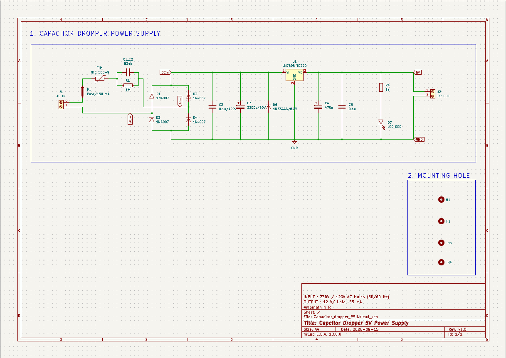
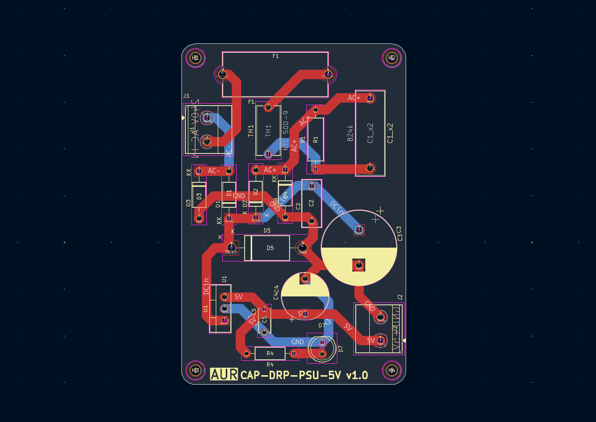
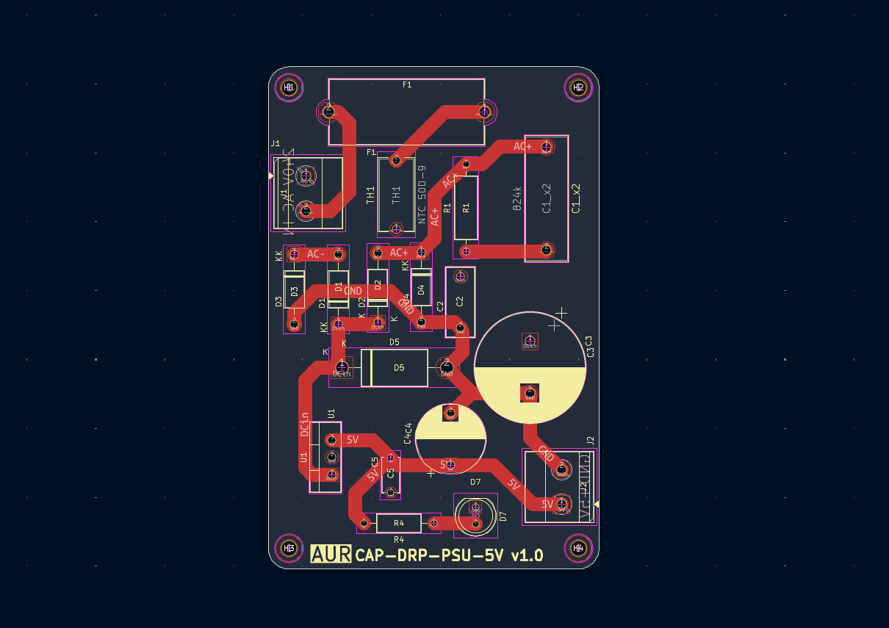
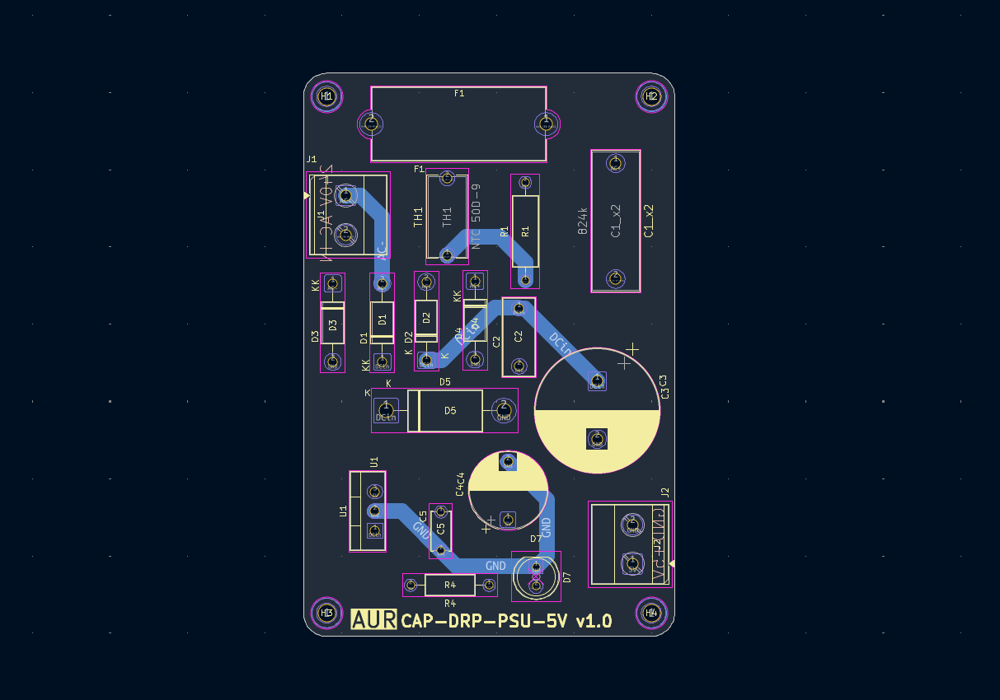
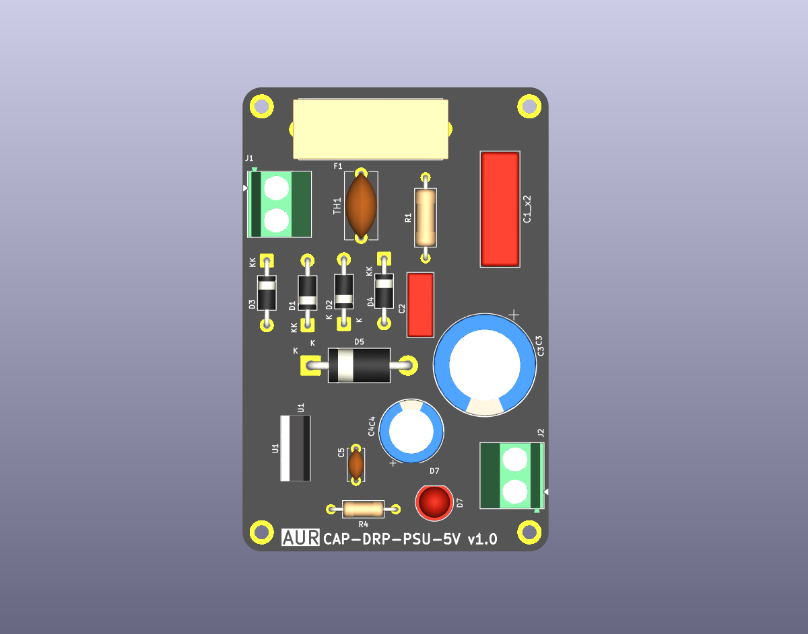
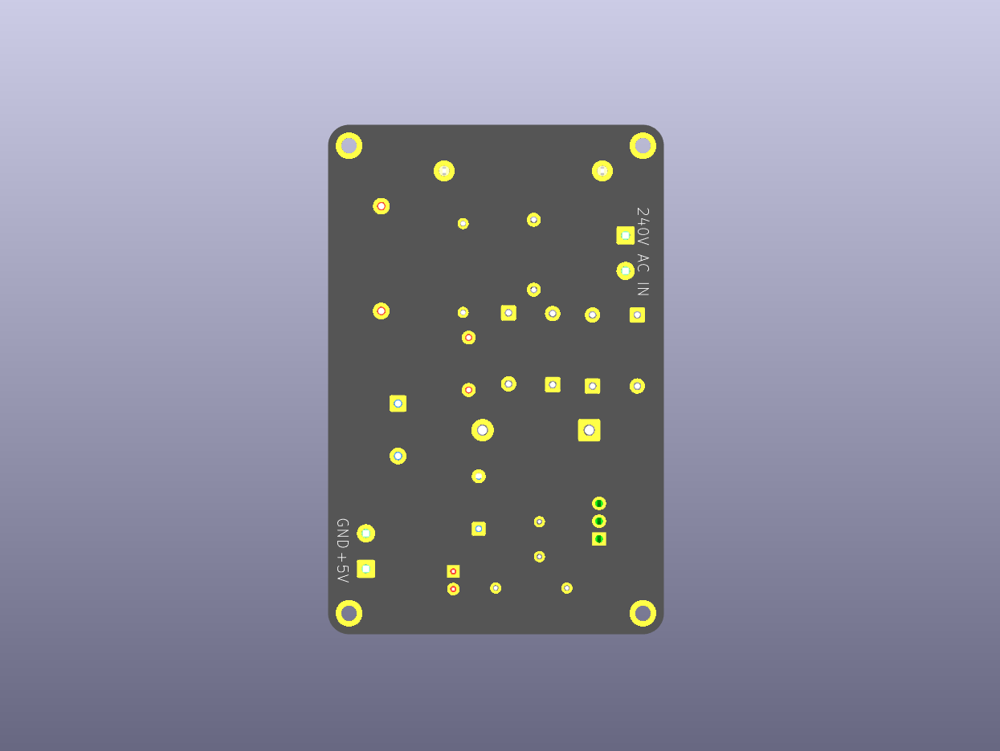

# Capacitive Dropper Power Supply

---

## Table of Contents

- [Overview](#overview)
- [Features](#features)
- [Specifications](#specifications)
- [Design Requirements](#design-requirements)
- [Circuit Design](#circuit-design)
- [Bill of Materials (BoM)](#bill-of-materials-bom)
- [Complete Circuit Description](#complete-circuit-description)
- [Safety Considerations](#safety-considerations)
- [License](#license)

---

## Overview

This project features a compact, non-isolated capacitive dropper power supply designed for low-power electronics experimentation and PCB design practice.

Operating directly from high-voltage AC mains (230V/120V), the circuit utilizes capacitive reactance rather than a bulky inductive transformer to limit the input current.

> ⚠️ **ELECTRIC SHOCK HAZARD:** This circuit is non-galvanically isolated. The entire PCB, components, and output terminals can be at hazardous mains potential when connected to the AC supply. Never touch the circuit while energized. Disconnect the mains supply before handling.

---

## Features

- **Transformerless Design:** Compact footprint utilizing an X2 safety capacitor for capacitive current limiting.
- **Voltage Regulation:** Zener diode-based voltage clamping and regulator circuitry.
- **PCB Design:** Custom PCB layout with optimized component placement and routing.
- **Mains Separation:** Physical separation between high-voltage AC and lower-voltage circuit sections.
- **Integrated Protection:** Includes an onboard fuse (`F1`) and NTC thermistor (`TH1`) for fault and inrush current mitigation.
- **THT Components:** Through-hole component-based design for easier assembly and inspection.

---

## Specifications

| Parameter | Value |
|:---|:---|
| **Input Voltage** | 230V / 120V AC Mains |
| **Input Frequency** | 50/60 Hz |
| **Dropper Capacitor** | 0.82 µF X2 Safety Capacitor |
| **Output Voltage** | Regulated DC (refer to schematic) |
| **Topology** | Non-Isolated Capacitive Dropper |
| **PCB Copper Thickness** | 1 oz/ft² |
| **PCB Trace Width** | 2mm–2.5mm (design-specific) |

---

## Design Requirements

- **Component Selection:** Selected a 0.82 µF (`824`) X2 safety capacitor for capacitive current limiting.
- **Current Limiting:** Capacitive reactance determines the approximate AC current supplied to the rectifier stage.
- **Layout Discipline:** Maintained physical separation between high-voltage AC traces and lower-voltage circuit sections.
- **Protection:** Incorporated a fuse and NTC thermistor for input protection.
- **PCB Optimization:** Focused on component placement, routing, and manufacturing considerations.

---

## Circuit Design

### 1. Working Principle

The capacitive dropper uses the capacitive reactance (Xc) of an X2 safety capacitor to limit the current flowing from the AC mains.

Unlike a conventional resistive voltage dropper, the capacitor limits current primarily through its frequency-dependent reactance.

### 2. Capacitive Reactance Calculation

The capacitive reactance is calculated using:

```text
                 1
Xc = -------------------------
          2 × π × f × C
```

Where:

- f = 50 Hz (Supply frequency)
- C = 0.82 µF (Dropper capacitance)
- π = 3.14159

Substituting the values:

```text
                 1
Xc = -----------------------------
     2 × 3.14159 × 50 × 0.82 × 10⁻⁶
```

Therefore:

```text
Xc ≈ 3880 Ω

Xc ≈ 3.88 kΩ
```

### 3. RMS Current Calculation

The ideal RMS current through the capacitor is calculated using:

```text
         Vrms
Irms = --------
          Xc
```

For a 230V, 50Hz AC supply:

```text
         230
Irms = -------
         3880
```

Therefore:

```text
Irms ≈ 0.0593 A

Irms ≈ 59.3 mA
```

**Important:** This is the ideal AC current through the dropper capacitor, NOT the guaranteed DC output current. The actual usable DC output current depends on the rectifier topology, filtering, voltage regulation, component tolerances, and load conditions.

### 4. Rectification and Regulation

After current limiting, the circuit uses a full-wave bridge rectifier to convert AC into pulsating DC.

The filtering capacitors smooth the rectified waveform, while the Zener diode and regulator circuitry provide voltage regulation.

---

### Schematic

<p align="center">
  
</p>

### PCB Layout

<p align="center">
  
</p>

### Copper Layers

<p align="center">
  
  
</p>

### 3D Model

<p align="center">
  
  
</p>

---

---

## Bill of Materials (BoM)

| Component | Value / Part Number |
|:---|:---|
| `C1_x2` | 824K (0.82 µF X2 Safety Capacitor) |
| `C2` | 0.1 µF / 400V |
| `C3` | 2200 µF / 50V |
| `C4` | 470 µF |
| `C5` | 0.1 µF |
| `D1, D2, D3, D4` | 1N4007 |
| `D5` | 1N5344B (8.2V Zener) |
| `D7` | Red LED |
| `F1` | 150 mA Fuse |
| `J1` | AC Input |
| `J2` | DC Output |
| `R1` | 1 MΩ |
| `R4` | 1 kΩ |
| `TH1` | NTC 50D-9 |
| `U1` | LM7805 (TO-220) |

---

## Complete Circuit Description

### 1. AC Mains Input and Protection (`J1`, `F1`, `TH1`)

High-voltage AC enters through the input screw terminals (`J1`).

The input protection stage incorporates:

- Fuse (`F1`) for overcurrent protection.
- NTC thermistor (`TH1`) for limiting inrush current.

### 2. Capacitive Dropper Stage (`C1_x2`, `R1`)

The 0.82 µF X2 safety capacitor (`C1_x2`) provides capacitive reactance to limit the AC current.

A high-value bleeder resistor (`R1`) is connected in parallel with the dropper capacitor to discharge its stored charge after disconnection.

### 3. Rectification (`D1`–`D4`)

Four 1N4007 diodes form a full-wave bridge rectifier.

The rectifier converts the AC waveform into pulsating DC.

### 4. Voltage Regulation and Filtering (`D5`, `C2`–`C5`, `U1`)

The Zener diode (`D5`) provides voltage clamping at its designated circuit node.

The filtering capacitors reduce voltage ripple, while the LM7805 regulator (`U1`) provides regulated 5V output when operated within its electrical and thermal limits.

### 5. Output Stage (`J2`)

The regulated DC output is available through the output connector (`J2`).

---

## Safety Considerations

> ⚠️ **HIGH-VOLTAGE WARNING**

This is a non-isolated AC mains-powered circuit.

- The output is NOT galvanically isolated from the mains.
- Never connect the output directly to a computer, USB port, grounded oscilloscope, or other grounded equipment.
- Never touch the PCB while connected to the mains.
- Disconnect power before testing or handling the circuit.
- Verify component voltage ratings and fuse selection.
- Ensure appropriate creepage and clearance distances according to the applicable safety standards.
- A qualified electrical safety review is required before practical use.

The stated PCB trace widths and physical spacing should not be interpreted as proof of mains safety compliance.

---

## License

MIT License — see [LICENSE](LICENSE) for details.
